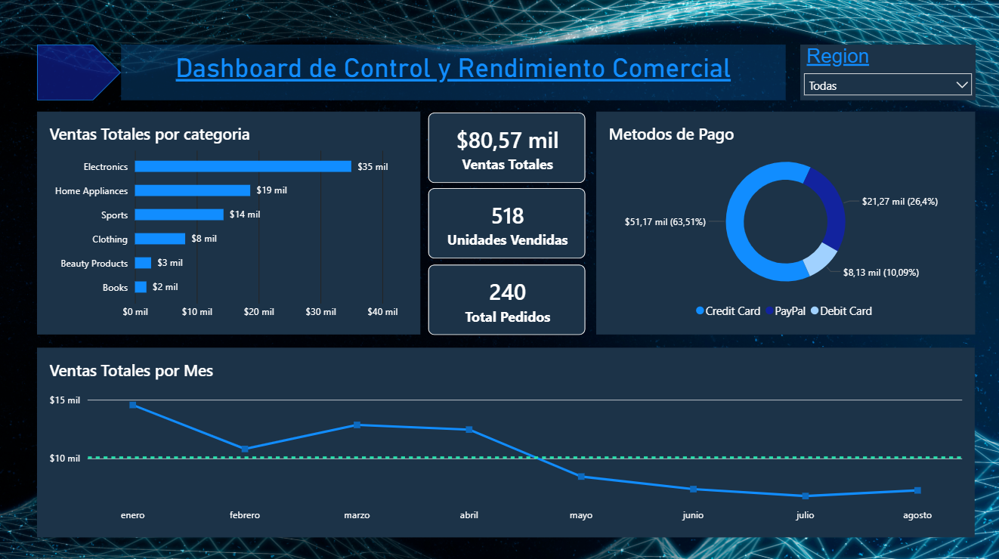

# Dashboard comercial | Control de ventas

**Power BI · DAX · MySQL**

**Organicé las ventas en un dashboard que permite identificar categorías líderes, comparar regiones y revisar la evolución mensual.** Electronics concentra el mayor ingreso y Credit Card reúne el mayor importe por método de pago. Estos hallazgos orientan dónde profundizar el análisis comercial.

El caso utiliza **240 pedidos y 518 unidades**, con **80.567,85 unidades monetarias** de ventas registradas entre el **1 de enero y el 27 de agosto de 2024**. MySQL almacena los datos y Power BI los presenta mediante indicadores, gráficos y un filtro de región.

## Qué responde el dashboard

| Pregunta | Resultado observado | Qué revisaría |
|---|---|---|
| ¿Qué categoría genera más ingresos? | **Electronics: 34.982,41**, seguida de Home Appliances. | Disponibilidad y composición de los productos destacados. |
| ¿Qué método de pago concentra las ventas? | **Credit Card: 63,51 %** del importe total. | Continuidad operativa de ese medio de pago. |
| ¿Cómo evolucionan las ventas? | Enero registra **14.548,32**; julio, **6.797,08**, el menor importe mensual del período. | La composición por categoría y región antes de atribuir causas. |
| ¿Cómo cambia el resultado por región? | El filtro permite explorar North America, Europe y Asia. | Diferencias de ventas y categorías dentro de cada región. |

Son propuestas de revisión a partir de los datos; el informe no demuestra aumentos de ventas ni ahorro de tiempo.

## Evidencia del informe

La vista general reúne ventas por categoría, participación de pagos, tendencia mensual y los indicadores de ventas, unidades y pedidos.

La captura está en `dashboardvista.png`; el informe para explorar está en `Dashboard comercial.pbix`.

## Cómo preparé el análisis

Cargué los datos en la tabla `ventas_raw` de MySQL y la importé en Power BI. Añadí el calendario `calc_calendario` para organizar las fechas y centralicé los indicadores DAX en `_medidas`.

El modelo utiliza una tabla de ventas, un calendario y una tabla de medidas. La conexión funciona en modo **Import**: los cambios de MySQL se reflejan al actualizar el informe.

## Dónde encontrar cada parte

| Archivo o carpeta | Contenido |
|---|---|
| `Dashboard comercial.pbix` | Informe interactivo de Power BI. |
| `dashboardvista.png` | Captura de la vista general. |
| `dbventas2024.sql` | Estructura y datos de la tabla de ventas. |
| `docs/reproduccion.md` | Pasos para abrir el informe y conectar tu MySQL. |

Los importes representan ingresos registrados, no beneficios. La comparación mensual corresponde al período disponible, con agosto hasta el día 27. La documentación original identifica la fuente como *Online Sales Dataset*; el SQL no especifica divisa.
